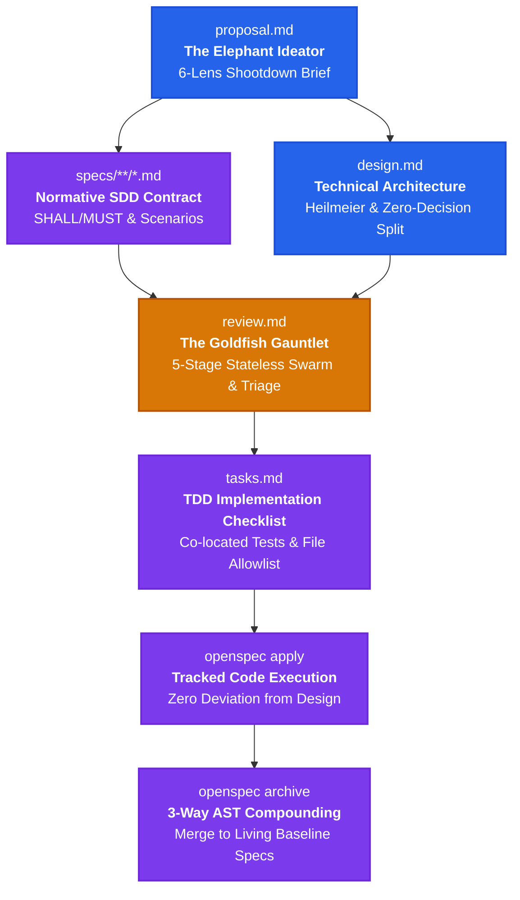

# OpenSpec EGM Schema: Google Elephant-Goldfish Model for OpenSpec

<p align="center">
  <a href="https://github.com/lutfi-zain/openspec-schema-egm"></a>
</p>

<p align="center">
  <strong>Design with an Elephant. Review with a Goldfish. Compound with OpenSpec.</strong>
</p>

<p align="center">
  <a href="https://github.com/lutfi-zain/openspec-schema-egm/blob/main/LICENSE"></a>
  <a href="https://github.com/Fission-AI/openspec"></a>
  <a href="https://github.com/google/elephant-goldfish-model"></a>
  <a href="https://sdd.membran.app"></a>
</p>

<br>

**`openspec-schema-egm`** is a high-rigor, production-grade workflow schema for [OpenSpec](https://github.com/Fission-AI/openspec) that implements Google's [Elephant-Goldfish Model (EGM)](https://github.com/google/elephant-goldfish-model).

It bridges the gap between **upstream epistemic rigor** (adversarial stress-testing by isolated zero-context reviewers) and **downstream compounding execution** (test-driven task checklists and atomic 3-way AST living specification merges).

---

## The Problem: Why Standard SDD Still Fails

Autonomous AI coding agents frequently fall into four failure modes:
1. **Self-Review Confirmation Bias**: When the same agent session creates the proposal, writes the design, and reviews itself, it reflexively validates its own faulty assumptions instead of catching critical flaws.
2. **Premature Implementation ("Weeds Syndrome")**: Agents jump immediately into writing code in nearby files before analyzing YAGNI (simplicity), existing library reuse, or database concurrency.
3. **Chat Dump & Context Degradation**: Multi-page specifications dumped into chat degrade model reasoning across long sessions.
4. **Documentation Drift**: Static design documents in `docs/designs/` rot as soon as the code evolves, leaving future agents with stale context.

---

## The Solution: Unified SDD Pipeline

By combining Google EGM's cognitive asymmetry with OpenSpec's compounding specification engine, we establish a continuous, disciplined engineering pipeline:



---

## Head-to-Head Comparison

| Dimension | Standard OpenSpec (`spec-driven`) | Standard Google EGM | OpenSpec EGM Schema (This Package) |
| :--- | :--- | :--- | :--- |
| **Upstream Ideation** | Unstructured freeform proposal | 6-lens shootdown (`concepts_brief.md`) | 🏆 **Structured 6-lens shootdown** (`proposal.md`) |
| **Adversarial Peer Review** | ❌ None (Self-Review by same agent) | ✅ 5-stage zero-context subagent swarm | 🏆 **5-stage zero-context subagent swarm** (`review.md`) |
| **Review Convergence Triage** | ❌ None | ✅ 4-way triage (`PROPOSE FIX`, `CONTEST`, etc.) | 🏆 **4-way triage + 2 clean rounds signoff** |
| **Specification Standard** | Normative Delta Specs (SHALL/MUST) | Narrative design document | 🏆 **Normative Delta Specs + Heilmeier Catechism** |
| **Implementation Plan** | Checkbox tasks (`tasks.md`) | Narrative steps in design doc | 🏆 **Checkbox tasks adhering to Zero-Decision Rule** |
| **Living Spec Compounding** | ✅ 3-way AST merge (`specs-apply.ts`) | ❌ None (Static docs in `docs/designs/`) | 🏆 **3-way AST merge into `openspec/specs/**`** |
| **Documentation Drift** | Zero drift | ⚠️ High risk (Manual drift reports) | 🏆 **Zero drift (Living truth guaranteed)** |

---

## The 5-Stage Goldfish Review Gauntlet

During the `review` phase, review subagents are spawned in **isolated, zero-context sessions** (`omitClaudeMd: true` / `fork_turns: 'none'`) with no conversation history. Reviewers operate under cold, adversarial standards:

```text
├── Stage 1: Initial Zoom-Out Review
│   └── Tests simplicity, YAGNI, and existing codebase/infrastructure reuse (zoom-out-standard).
├── Stage 2: Naive Reader Comprehension Test
│   └── Mandatory 2-heading paraphrase ("What this system does" & "How this system works") before any critique.
├── Stage 3: Design Critique & System Failure Modes
│   └── Evaluates scale, concurrency, SQLite WAL/lock modes, route collisions, and security.
├── Stage 4: Intermediate Zoom-Out Review
│   └── Audits documents for defensive bloat or over-engineering introduced during earlier fixes.
└── Stage 5: Implementation Readiness Test
    └── Audits the Detailed Implementation Plan against the Zero-Decision Rule and strict File Allowlist.
```

Findings are triaged into **🔴 Blocker**, **🟡 Major**, and **🟢 Nit**, with a mandatory **2-round clean pass (0 Blockers, 0 Majors)** before tasks can be generated.

---

## Empirical Benchmark Validation

In an end-to-end live benchmark building a full-stack **Todo PWA (Svelte 5 + Tailwind + Hono + SQLite)** from identical prompts, this schema demonstrated superior defect detection:

| Benchmark Metric | OpenSpec Standard | Google EGM Standard | OpenSpec EGM (This Schema) |
| :--- | :---: | :---: | :---: |
| **Automated Test Pass Rate** | 7/7 (100%) | 16/16 (100%) | 🏆 **17/17 (100%)** |
| **Critical Defects Caught Pre-Code** | 0 (None) | 4 Blockers, 5 Majors | 🏆 **2 Blockers, 4 Majors** |
| **Route Collision Prevention** | ❌ Missed | ✅ Caught & Fixed | 🏆 **Caught & Fixed (`/:id{\\d+}`)** |
| **SQLite Concurrency Hardening** | ❌ Omitted `busy_timeout` | ✅ WAL + `busy_timeout` | 🏆 **WAL + `busy_timeout = 5000;`** |
| **Priority Semantic Sort Flaw** | ❌ Alphabetical Sort | ✅ Custom SQL Mapping | 🏆 **SQL `CASE` Semantic Sort** |
| **Living Baseline Compounding** | ✅ Compounded | ❌ Static File Only | 🏆 **Compounded into Living Specs** |

*Live comparison dashboard running at [sdd.membran.app](https://sdd.membran.app).*

---

## Installation

### Option 1: One-Liner Global Install (Recommended)
Installs the schema globally for all projects on your machine:

```bash
curl -fsSL https://raw.githubusercontent.com/lutfi-zain/openspec-schema-egm/main/install.sh | bash
```

*Installed to `~/.local/share/openspec/schemas/egm` (Linux/macOS) or `%LOCALAPPDATA%\openspec\schemas\egm` (Windows).*

### Option 2: Project-Level Install via Degit
Installs the schema directly into your project's repository so your entire team shares it:

```bash
npx degit lutfi-zain/openspec-schema-egm openspec/schemas/egm
```

### Option 3: Manual Clone
```bash
git clone https://github.com/lutfi-zain/openspec-schema-egm.git openspec/schemas/egm
```

---

## Quickstart & Usage

### 1. Start a New Change
```bash
openspec new change add-webhook-delivery --schema egm
```

### 2. Follow the SDD Workflow
OpenSpec automatically guides your AI coding agent through each unblocked stage:

```bash
# Phase 1: Upstream Elephant Ideation (6-lens shootdown brief)
openspec instructions proposal --change add-webhook-delivery

# Phase 2: Normative Delta Specifications (WHAT)
openspec instructions specs --change add-webhook-delivery

# Phase 3: Technical Architecture & Semantic Split (HOW)
openspec instructions design --change add-webhook-delivery

# Phase 4: The 5-Stage Goldfish Review Gauntlet
openspec instructions review --change add-webhook-delivery

# Phase 5: Actionable TDD Tasks Checklist
openspec instructions tasks --change add-webhook-delivery

# Phase 6: Code Implementation & Test Execution
openspec apply --change add-webhook-delivery

# Phase 7: Atomic 3-Way AST Merge into Living Baseline Truths
openspec archive add-webhook-delivery --yes
```

---

## Project Configuration (`openspec/config.yaml`)

To set `egm` as the default schema and configure project-level constraints:

```yaml
schema: egm

context: |
  Tech Stack: TypeScript, Node.js (>= 22), Svelte 5, Hono, SQLite
  Architecture: Spec-Driven Development with EGM Zero-Decision Standards

rules:
  proposal:
    - Never include internal implementation mechanics; focus 100% on the problem and observable behavior.
    - Explicitly challenge feature necessity (YAGNI) across all 6 lenses.
    - One question at a time. Zero flattering adjectives or polite apologies.
  design:
    - Strictly design-only scope. You are forbidden from modifying production code.
    - Always insert the exact dividing header '## Detailed Implementation Plan'.
    - Address all 8 Heilmeier questions in the architecture section.
  review:
    - Spawn reviewer subagents in isolated zero-context contexts (omitClaudeMd: true, fork_turns: 'none').
    - Reviewers must strictly cite file:line references for every identified issue.
    - Reviewers must not offer praise; start directly with identified blockers and risks.
  tasks:
    - Every task must be a checkbox '- [ ] X.Y Task description' with explicit verification commands.
    - Co-locate unit tests within each task group; never dump tests into a final group.

operations:
  apply:
    guidance: |
      Verify that review.md has zero unresolved Blockers before modifying code.
      Follow the Target Scope file allowlist from design.md. Do not touch unapproved files.
  archive:
    guidance: |
      Ensure all tasks in tasks.md are checked ([x]).
      Verify that specs-apply 3-way merge succeeds cleanly without unmerged delta salvage warnings.
```

---

## License

[Apache-2.0](LICENSE) © 2026 [Lutfi](https://github.com/lutfi-zain)
