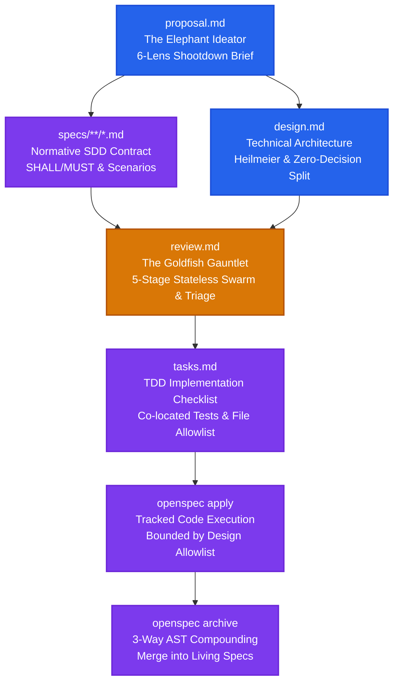

# OpenSpec EGM schema: Google Elephant-Goldfish Model for OpenSpec

<p align="center">
  <a href="https://github.com/lutfi-zain/openspec-schema-egm"></a>
</p>

<p align="center">
  Design with an Elephant. Review with a Goldfish. Compound with OpenSpec.
</p>

<p align="center">
  <a href="https://github.com/lutfi-zain/openspec-schema-egm/blob/main/LICENSE"></a>
  <a href="https://github.com/Fission-AI/openspec"></a>
  <a href="https://github.com/google/elephant-goldfish-model"></a>
</p>

<br>

`openspec-schema-egm` brings Google's [Elephant-Goldfish Model (EGM)](https://github.com/google/elephant-goldfish-model) into [OpenSpec](https://github.com/Fission-AI/openspec).

It pairs deep-context spec drafting with fresh-context adversarial reviewers to catch architectural blind spots before code gets written, then uses OpenSpec's 3-way AST merge to keep your living specifications in sync as you ship changes.

---

## Why this exists

When an AI coding agent plans and implements a feature in the same conversation, it tends to rubber-stamp its own ideas. It creates a proposal, writes a design doc, and confirms everything looks great because it is grading its own homework. Sneaky issues like route collisions, database lock timeouts, or missing parameter validation slip right past into production code.

Google's Elephant-Goldfish Model (EGM) tackled this on the design side:
- The Elephant: An agent with full project context explores the problem and drafts the specification.
- The Goldfish: Stateless subagent reviewers with zero conversation history evaluate the draft against strict rubrics without conversational bias.
- The human engineer: Resolves trade-offs and approves the plan.

EGM by itself stops at static Markdown files in `docs/designs/`. Once the feature is built, those documents begin rotting.

OpenSpec solves the living maintenance side: it breaks changes into delta specs and task checklists, then uses an atomic 3-way AST merge (`specs-apply.ts`) to compound those deltas directly into your repository's living baseline specs (`openspec/specs/**`).

This schema combines both. You get fresh-context review gauntlets before writing code, and automated living spec updates when you finish.

---

## How it works

The workflow runs as a 5-node directed acyclic graph (DAG):



### Stage breakdown

| Artifact | Output target | Role and process |
| :--- | :--- | :--- |
| `proposal` | `proposal.md` | Elephant Ideation: Interactive problem exploration across 6 lenses (Contrarian/YAGNI, Cost & Token Economics, UX & Ergonomics, Migration & Compatibility, Observability, and Long-Term Tech Debt). Enforces one question at a time and zero flattery. |
| `specs` | `specs/**/*.md` | Normative Contract (WHAT): Capability deltas (`ADDED`, `MODIFIED`, `REMOVED`, `RENAMED`) with SHALL/MUST requirements and WHEN/THEN scenarios. |
| `design` | `design.md` | Technical Architecture (HOW): Answers the 8 Heilmeier questions and sets the semantic split header `## Detailed Implementation Plan` separating high-altitude design from code-level execution. Enforces a strict File Allowlist and the Zero-Decision Rule. |
| `review` | `review.md` | The Goldfish Gauntlet: Dispatches isolated, zero-context reviewers across 5 stages (Initial Zoom-Out, Comprehension Paraphrase, Design Critique, Intermediate Zoom-Out, and Implementation Readiness). Triages findings with 4-way disposition (`PROPOSE FIX`, `CONTEST`, `ESCALATE`, `DECLINE`) and requires 2 clean rounds before tasks unlock. |
| `tasks` | `tasks.md` | Implementation Tasks: Checkbox list (`- [ ]`) generated only after verified review approval. Requires co-located unit tests for each task group. |

---

## The 5-stage goldfish review gauntlet

During the `review` phase, review subagents run in isolated, zero-context sessions (`omitClaudeMd: true` or `fork_turns: 'none'`) with no chat history. They evaluate the proposal, specs, and design against cold standards:

```text
├── Stage 1: Initial Zoom-Out Review
│   └── Tests simplicity, YAGNI, and existing codebase or library reuse.
├── Stage 2: Naive Reader Comprehension Test
│   └── Mandatory 2-heading paraphrase ("What this system does" and "How this system works") before any critique.
├── Stage 3: Design Critique & System Failure Modes
│   └── Evaluates scale, concurrency, SQLite WAL/lock modes, route collisions, and security.
├── Stage 4: Intermediate Zoom-Out Review
│   └── Audits documents for defensive bloat or over-engineering introduced during earlier fixes.
└── Stage 5: Implementation Readiness Test
    └── Audits the Detailed Implementation Plan against the Zero-Decision Rule and strict File Allowlist.
```

Findings are triaged into Blocker, Major, and Nit categories, with a mandatory signoff of zero Blockers and zero Majors before moving to tasks.

---

## Practical test results

To see how this works in practice, we ran a side-by-side test building a full-stack Todo PWA (Svelte 5, Hono, SQLite) using three workflows with the exact same initial prompt:

| Workflow | Review method | Pre-code blockers caught | Automated tests passed | Living spec status |
| :--- | :---: | :---: | :---: | :---: |
| OpenSpec Standard | Self-Review (In-thread) | 0 (Missed) | 7/7 | Compounded |
| Google EGM Standard | Goldfish Review | 4 Blockers, 5 Majors | 16/16 | Static Markdown |
| OpenSpec EGM (This Schema) | True Zero-Context Goldfish | 2 Blockers, 4 Majors | 17/17 | Compounded via 3-way AST merge |

Standard OpenSpec completed quickly, but its self-review completely missed a route collision between a batch delete endpoint and an ID parameter route, as well as SQLite lock timeouts under write load.

The Goldfish review stage in this schema caught both issues before any code was written. It forced the agent to add regex parameter constraints (`/:id{\d+}`) and configure proper SQLite WAL pragmas with busy timeouts. Once approved, the changes were archived directly into living specs with 17 passing tests.

---

## Installation

### Option 1: One-liner script (Recommended)
Installs the schema globally for all projects on your machine:

```bash
curl -fsSL https://raw.githubusercontent.com/lutfi-zain/openspec-schema-egm/main/install.sh | bash
```

*Installed to `~/.local/share/openspec/schemas/egm` (Linux/macOS) or `%LOCALAPPDATA%\openspec\schemas\egm` (Windows).*

### Option 2: Project-level install via degit
Installs the schema directly into your project's repository so your entire team shares it:

```bash
npx degit lutfi-zain/openspec-schema-egm openspec/schemas/egm
```

### Option 3: Manual git clone
```bash
git clone https://github.com/lutfi-zain/openspec-schema-egm.git openspec/schemas/egm
```
---

## Quickstart and usage

### 1. Start a new change
```bash
openspec new change add-webhook-delivery --schema egm
```

### 2. Follow the workflow
OpenSpec guides your agent through each stage:

```bash
# Phase 1: Upstream Elephant Ideation (6-lens shootdown brief)
openspec instructions proposal --change add-webhook-delivery

# Phase 2: Normative Delta Specifications (WHAT)
openspec instructions specs --change add-webhook-delivery

# Phase 3: Technical Architecture & Semantic Split (HOW)
openspec instructions design --change add-webhook-delivery

# Phase 4: The 5-Stage Goldfish Review Gauntlet
openspec instructions review --change add-webhook-delivery

# Phase 5: Implementation Tasks Checklist
openspec instructions tasks --change add-webhook-delivery

# Phase 6: Code Implementation & Test Execution
openspec apply --change add-webhook-delivery

# Phase 7: Atomic 3-Way AST Merge into Living Baseline Truths
openspec archive add-webhook-delivery --yes
```

---

## Project configuration (`openspec/config.yaml`)

To make `egm` your project's default schema and set specific quality rules:

```yaml
schema: egm

context: |
  Tech Stack: TypeScript, Node.js (>= 22), Svelte 5, Hono, SQLite
  Architecture: Spec-Driven Development with EGM Zero-Decision Standards

rules:
  proposal:
    - Never include internal implementation mechanics; focus 100% on the problem and observable behavior.
    - Explicitly challenge feature necessity (YAGNI) across all 6 lenses.
    - One question at a time. Zero flattering adjectives or polite apologies.
  design:
    - Strictly design-only scope. You are forbidden from modifying production code.
    - Always insert the exact dividing header '## Detailed Implementation Plan'.
    - Address all 8 Heilmeier questions in the architecture section.
  review:
    - Spawn reviewer subagents in isolated zero-context contexts (omitClaudeMd: true, fork_turns: 'none').
    - Reviewers must strictly cite file:line references for every identified issue.
    - Reviewers must not offer praise; start directly with identified blockers and risks.
  tasks:
    - Every task must be a checkbox '- [ ] X.Y Task description' with explicit verification commands.
    - Co-locate unit tests within each task group; never dump tests into a final group.

operations:
  apply:
    guidance: |
      Verify that review.md has zero unresolved Blockers before modifying code.
      Follow the Target Scope file allowlist from design.md. Do not touch unapproved files.
  archive:
    guidance: |
      Ensure all tasks in tasks.md are checked ([x]).
      Verify that specs-apply 3-way merge succeeds cleanly without unmerged delta salvage warnings.
```

---

## License

[Apache-2.0](LICENSE) © 2026 [Lutfi](https://github.com/lutfi-zain)
